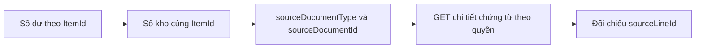

## P6.1 — Đối chiếu tồn của một mặt hàng

Gọi GET `/api/v1/inventory/balances?itemId=…` rồi GET `/api/v1/inventory/transactions?itemId=…&sortBy=id&sortDirection=asc`. Duyệt đủ các trang. Khi kho đầu bằng 0 và không có nghiệp vụ ghi xen vào, tổng `quantityDelta` bằng `quantityOnHand` hiện tại. Số dư hiện tại và từng trang lịch sử là các lần đọc riêng. Lọc ngày sẽ chỉ còn biến động trong kỳ.

Với tiêu hao sản xuất, dòng nguồn là ID nguyên liệu snapshot; nhập thành phẩm dùng dòng nguồn 0. Với mua và bán, đó là ID dòng chứng từ. Để debug, theo [InventoryController](../BttMiniERP.Api/Controllers/InventoryController.cs) đến [InventoryQueryService](../BttMiniERP.Api/Services/InventoryQueryService.cs). Kiểm tra bộ lọc trước bước CountAsync và kiểm tra thứ tự cùng ID trước Skip/Take.
