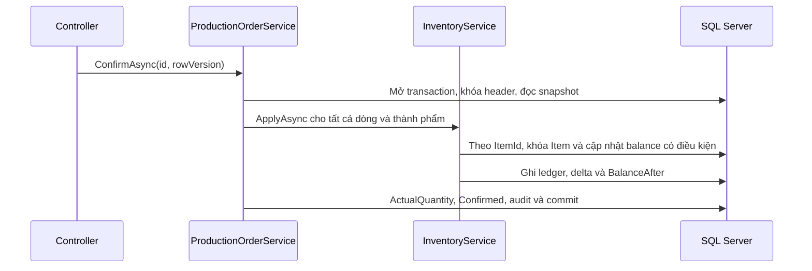

# Lệnh sản xuất từ Draft đến ghi kho

Khi tạo Draft, service chụp phiên bản BOM, từng NVL và định mức. Khi sửa sản lượng, service tính lại nhu cầu từ snapshot. Khi confirm, client chỉ gửi rowVersion. Ví dụ tồn NVL là 10, định mức 2 và sản lượng 3 thì giao dịch tiêu hao 6 NVL, còn 4, đồng thời nhập 3 thành phẩm.

Dòng tiêu hao có delta âm và SourceLineId bằng ID dòng snapshot. Dòng thành phẩm có delta dương và SourceLineId bằng 0. InventoryService xử lý thứ tự khóa theo ItemId kể cả thành phẩm. Mọi lần ghi ở bên trong transaction của lệnh. Nếu dòng cuối thiếu hàng, cả lần tăng thành phẩm hoặc trừ NVL trước đó cũng rollback. Confirm lần hai trả 409.

Đối chiếu [service](../../BttMiniERP.Api/Services/ProductionOrderService.cs), [quy tắc snapshot](../../BttMiniERP.Api/Services/ProductionOrderRules.cs), [cập nhật kho](../../BttMiniERP.Api/Services/InventoryService.cs), [test SQL](../../BttMiniERP.Tests/Integration/Production/ProductionConfirmationTests.cs) và [kết quả đã chạy](../test-results.md).