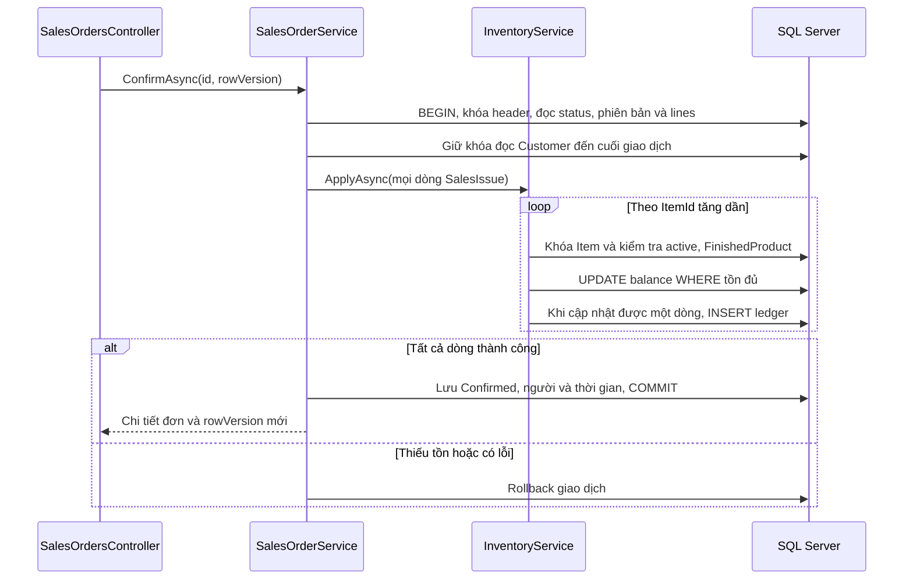

# Xác nhận đơn bán thành phẩm

Với một đơn Draft đã có dòng, lấy `rowVersion` từ GET chi tiết rồi gửi `POST /api/v1/sales-orders/{id}/confirm` với body `{"rowVersion":"…"}`. Khi nhận 409, tải lại đơn để phân biệt trạng thái đã kết thúc, phiên bản đã cũ hoặc thiếu hàng. Giá, số lượng và các dòng lấy từ đơn đã lưu. Xem [hợp đồng API](../api-plan.md) và [luật nghiệp vụ](../business-rules.md).

Khi debug, đặt breakpoint ở [LockOrder và ConfirmAsync](../../BttMiniERP.Api/Services/SalesOrderService.cs) để so phiên bản client với phiên bản sau khóa. Theo [ConfirmationMovements](../../BttMiniERP.Api/Services/SalesOrderRules.cs) để đối chiếu lượng âm và ID dòng nguồn. Trong [ApplyAsync](../../BttMiniERP.Api/Services/InventoryService.cs), `changed != 1` khiến nghiệp vụ trả 409. Savepoint bảo vệ các thay đổi kho; transaction ngoài bao gồm cả lần lưu audit cuối.

Kịch bản nghiệm thu có tồn 3 và hai đơn cùng bán 2. Khi cả hai xác nhận đồng thời, kết quả yêu cầu là một đơn Confirmed, một đơn Draft, một dòng SalesIssue và tồn cuối 1. [Bộ test SQL](../../BttMiniERP.Tests/Integration/Sales/SalesConfirmationTests.cs) và [test xuyên luồng Kestrel](../../BttMiniERP.Tests/Integration/Sales/SalesConfirmationRuntimeTests.cs) đã được viết; xem trạng thái thực thi trong [kết quả kiểm thử](../test-results.md).
